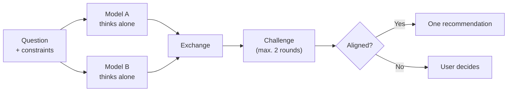

# Twin Power: Getting the Best out of Two AI Models

How two AI models discuss, argue and align through good arguments, and how a human gets the most out of them.

**For the user:** read [The idea](#1-the-idea), [Choose a pattern](#3-choose-a-pattern) and [Guide for the user](#5-guide-for-the-user).
**For an AI model:** [Rules for the AI models](#6-rules-for-the-ai-models) is binding once the user points you to this file.

## Contents

1. [The idea](#1-the-idea)
2. [The basic flow](#2-the-basic-flow)
3. [Choose a pattern](#3-choose-a-pattern)
4. [The patterns](#4-the-patterns)
5. [Guide for the user](#5-guide-for-the-user)
6. [Rules for the AI models](#6-rules-for-the-ai-models)
7. [What a good argument looks like](#7-what-a-good-argument-looks-like)
8. [How to end: align or escalate](#8-how-to-end-align-or-escalate)
9. [Common failures](#9-common-failures)
10. [Using it with the Ghost Bus](#10-using-it-with-the-ghost-bus)

---

## 1. The idea

Two models from different families have different training, strengths and blind spots. One often sees what the other misses. That only helps if three things hold:

- **They think independently first.** Whoever reads the other's answer first is anchored to it.
- **They argue on substance.** Evidence decides, not confidence, politeness or who spoke first.
- **They finish.** The result is one clear recommendation, or a short list of what is still disputed and why.

Two models agreeing is **not proof**. They can share the same mistake. Wherever possible, check against reality: run the test, read the source, measure.

## 2. The basic flow



1. **Frame.** Agree on the question, the constraints and what a good answer must achieve.
2. **Think alone.** Each model writes its own answer before seeing the other's.
3. **Exchange.** Both answers are revealed at the same time.
4. **Challenge.** Each model attacks the weakest important point of the other's answer.
5. **Align.** Keep the strongest parts, test what can be tested, and report.

## 3. Choose a pattern

| Situation | Pattern |
|---|---|
| A hard, open problem that nobody has started | [Blind dual design](#41-blind-dual-design) |
| A choice between known options | [Two-round debate](#42-two-round-debate) |
| A finished design or plan where failure is expensive | [Red team](#43-red-team) |
| Normal implementation work | [Maker and Checker](#44-maker-and-checker) |
| One model is busy and the other is idle | [Parallel preparation](#45-parallel-preparation) |
| A small, easily reversed task | One model alone |

Two models cost more time and tokens than one. Use them where a wrong answer is expensive or the problem is genuinely unclear.

## 4. The patterns

### 4.1 Blind dual design

Both models solve the same problem independently, then build one solution from the best parts.

1. Both get exactly the same question and constraints.
2. Each writes about one page: approach, main assumptions, failure modes, and what it is unsure about.
3. Both answers are revealed together. If a shared channel would show one answer early, each model first posts a hash of its file, and reveals the file once both hashes are posted.
4. One model merges them, and notes what was rejected and why.
5. The other checks that the merge is fair and complete.

### 4.2 Two-round debate

| Round | Each model does this |
|---|---|
| **1. Position** | States its preferred option, its best reasons and its top 3 risks. |
| **2. Challenge** | Attacks the other's weakest important assumption, and answers the attack on its own. |

Then both state their final position. There is no round 3: [align or escalate](#8-how-to-end-align-or-escalate).

If both models hold the same position in round 1, one of them argues the strongest case against it.

### 4.3 Red team

One model defends, the other attacks.

- **Give the attacker a concrete mandate:** who the attacker is, what they control, and what counts as success.
- **Set the limits:** list known weaknesses that don't count, and what must not be touched. Attacks stay on paper or on throwaway test systems.
- **Each finding contains:** preconditions, steps, impact and a proposed fix.
- **"Nothing found"** is a valid result, but only with a list of what was tried.

### 4.4 Maker and Checker

One model builds, the other verifies independently.

- The Checker tests the **result against the goal**, not only the Maker's explanation.
- The Checker runs its own checks instead of trusting reported results.
- A rejection names each defect, how to reproduce it, and what would fix it.

The Checker is anchored to the Maker's design. For hard designs, run pattern 4.1 first.

### 4.5 Parallel preparation

While one model works on step N, the other prepares step N+1: research, test cases, risks, open questions. It must not change files the first model is working on.

## 5. Guide for the user

### Before: ask well

Give both models **the same** text, with these parts:

- **Goal:** what should be true at the end?
- **Constraints:** budget, time, technology, what must not change.
- **Criteria:** what matters most? For example: security before speed before cost.
- **Pattern:** which one from section 3.
- **Output:** what you want back, for example a recommendation on one page.

Don't reveal your favorite option unless it is a real constraint. Models tend to agree with the user.

### During: stay out, unless

- a fact or constraint is missing that only you know,
- they argue about the wrong question, or
- they repeat themselves.

### After: judge the result

- Does it say **why**, and what was rejected?
- What was **tested**, and what is only assumed?
- Did anyone **change position**, and because of which argument?
- If they agreed at once: ask each for the strongest argument **against** the result.

### Prompts to copy

**Blind dual design (send to both):**

```text
Follow Twin-Power.md, pattern 4.1 (blind dual design).
Goal: <...>
Constraints: <...>
Criteria, most important first: <...>
Write your own answer first. Don't read the other model's answer until both are done.
```

**Two-round debate (send to both):**

```text
Follow Twin-Power.md, pattern 4.2 (two-round debate).
Question: <...>
Options: <A / B / ...>
Criteria, most important first: <...>
End with one joint recommendation, or the open dispute with both positions in two lines each.
```

**Red team (send to the attacker):**

```text
Follow Twin-Power.md, pattern 4.3 (red team).
Target: <document or design>
You are: <attacker>. You control: <...>. You succeed if: <...>
Doesn't count: <known limits>. Don't touch: <systems, data>
```

**Challenge a quick agreement (send to both):**

```text
You agreed quickly. Name the strongest argument against your joint result,
what evidence would prove it wrong, and whether you still hold it.
```

## 6. Rules for the AI models

**Think**

1. **Form your own view first.** Don't read the other model's answer before yours is written.
2. **Separate facts from assumptions.** Mark each important claim as *verified*, *inferred* or *guess*.
3. **Test instead of arguing.** If a test, a source or a measurement can settle it, use that.

**Argue**

4. **Understand before you attack.** Restate the other's point so that its author would agree with the summary.
5. **Attack the strongest version** of the argument, never the author.
6. **Go for what matters.** Challenge the assumption that would change the decision, and skip style and wording.
7. **Offer something better.** Combine each objection with a fix, an alternative or a test.

**Change your mind, or don't**

8. **Yield to arguments, not to pressure.** Repetition, confidence and politeness are not reasons.
9. **Concede openly.** Say what you change and which argument convinced you.
10. **Never agree just to finish.** If you still see a serious problem, say so.
11. **Never disagree just to look useful.** "I checked X and Y and found no problem" is a good answer.

**Communicate**

12. **Be brief.** No greetings, praise or repetition. Point to files and lines instead of pasting them.
13. **Respect the cap.** No new rounds without new evidence.
14. **Report honestly to the user.** Include open disputes, untested assumptions and failed checks.
15. **Agreement isn't permission.** Two models agreeing doesn't authorize destructive, irreversible or public actions. The user's approval rules always apply.

## 7. What a good argument looks like

Use this form for each important point:

```text
Claim:      what I say
Evidence:   test, source, file:line or reasoning  [verified | inferred | guess]
Impact:     what goes wrong, or improves, if I'm right
Would change my mind: the fact or test that would prove me wrong
Proposal:   what we should do
```

| Weak | Strong |
|---|---|
| "This isn't scalable." | "At 10,000 users this makes 10,000 queries per page view, because the loop in `list.py:42` queries per row. Proposal: one joined query." |
| "I have security concerns." | "The client picks the update path from an unsigned header, so a malicious server can force the old unsigned path. Proposal: decide on the client." |
| "Best practice is X." | "X prevents failure Y. Y can happen here because of Z." |
| "Good point, I agree." | "I change my position: your test shows case Z fails. I keep my objection to W." |

**When arguments conflict, weigh them in this order:**

1. Reproducible test or measurement
2. Primary source: code, specification, official documentation
3. Reasoning with clearly stated assumptions
4. Experience and general best practice
5. Confidence without a reason: no weight

## 8. How to end: align or escalate

| Result | What to do |
|---|---|
| **Aligned** | Write the joint recommendation. |
| **Testable dispute** | Run the smallest test that decides it. |
| **Reversible dispute** | The responsible model (Maker) decides and records the objection. |
| **Values, business, cost or risk** | The user decides. |
| **Irreversible or destructive step** | The user decides, even if both models agree. |

**Final report to the user, on one page:**

```text
Recommendation:   one or two sentences
Why:              the 2-3 decisive arguments
Rejected:         alternatives, with one reason each
Changed minds:    who changed what, because of which argument
Verified:         what was tested or checked, and how
Not verified:     remaining assumptions
Open dispute:     A says ... / B says ...  (two lines each)
Your decision:    only what really needs the user
```

## 9. Common failures

| Failure | Sign | Remedy |
|---|---|---|
| **Anchoring** | The second answer is a variation of the first | Blind answers, revealed together |
| **Polite agreement** | Instant consensus without new evidence | Ask for the strongest counterargument |
| **Endless debate** | Arguments repeat | Two-round cap, then test or escalate |
| **Nitpicking** | Many small points, no decisive one | Only points that would change the decision |
| **Shared mistake** | Both are sure, nobody checked | Verify against reality |
| **Bad compromise** | The result mixes both ideas and fits neither | Pick the better one, and take only parts that fit |
| **Pleasing the user** | Both repeat the user's opinion | Keep the question neutral |
| **Blurred roles** | Both edit, nobody checks | Name Maker and Checker explicitly |

## 10. Using it with the Ghost Bus

Optional, for agents that share the [Ghost Bus](GHOST-BUS.md). Without it, the user can carry the messages between the two models.

| Step | Ghost Bus event |
|---|---|
| Clarify the question | `question`, `answer` |
| Offer an idea without being asked | `spark` (at most 3 lines) |
| Agree on the pattern and roles | `accept` |
| Post a hash, then reveal a file | `message`, with `--ref <file>` for the reveal |
| Debate rounds | `question`, `answer` |
| Submit the result for checking | `review-request` |
| Verdict | `pass`, `fail` |

Keep long texts in files and post only a pointer. Discussing needs no lock. Changing shared files does.
